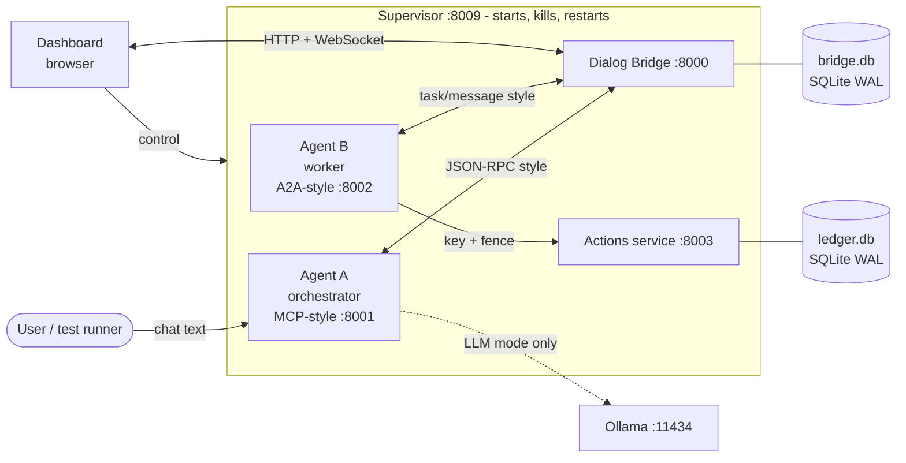
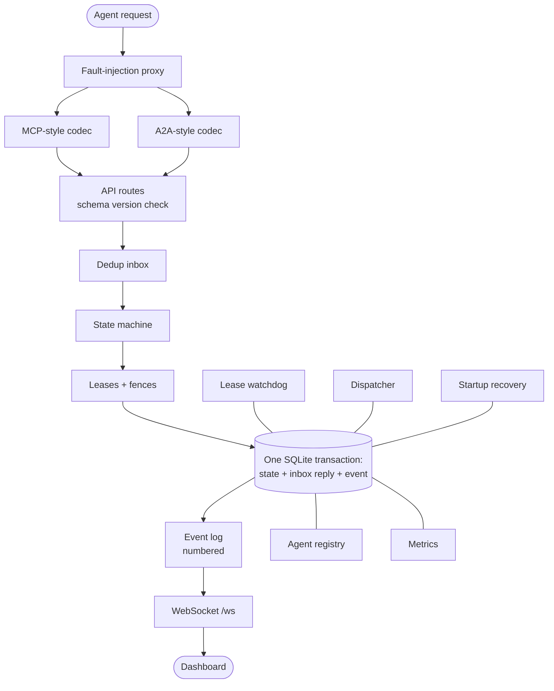
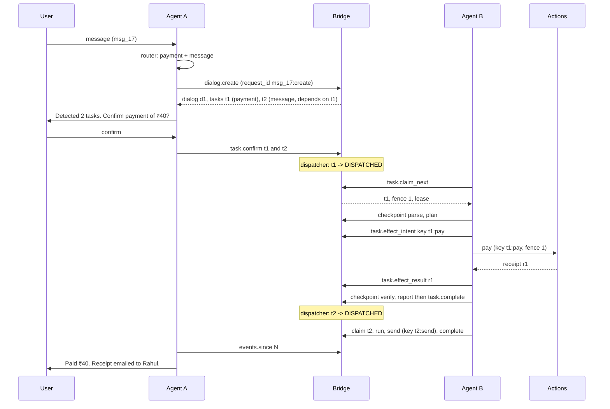

# Architecture

## One-sentence summary

Two mock agents never talk to each other directly: every message goes through
the **Dialog Bridge**, which owns all state in SQLite, so any process can crash
and the work continues with the same identity and without repeated side effects.

## System view

Rules that follow from this picture:

1. **Agents are stateless between restarts.** Anything an agent needs after a
   crash is read back from the bridge (`/resume`), never from its own memory.
2. **Only Agent B performs side effects**, and only through the actions service.
3. **The bridge is the only writer of task state.** Agents ask; the bridge decides.
4. **The actions service guards side effects independently** with its own
   idempotency ledger, so even a bridge bug cannot cause a double payment.

## Inside the bridge

The request path, in order:

| Step | Component | What it decides |
| --- | --- | --- |
| 1 | Proxy | Does this message get through? Dropped, delayed, duplicated, or cut. |
| 2 | Codec | Translate native format → shared schema envelope. |
| 3 | Route | Is the envelope valid, and is the schema version supported? |
| 4 | Inbox | Has this `request_id` been processed before? If yes, return the stored reply. |
| 5 | State machine | Is this transition allowed from the current state? |
| 6 | Leases | Does the sender own the task, with the current fence? |
| 7 | Transaction | Write the new state, the inbox reply and the event **together**. |
| 8 | Event fan-out | Push the event to the dashboard. |
| 9 | Codec | Translate the reply back to the sender's native format. |

Steps 4–7 happen inside **one** database transaction. A crash at any point
leaves either everything written or nothing written.

## Background jobs

| Job | Runs | Purpose |
| --- | --- | --- |
| Lease watchdog | every `WATCHDOG_TICK` | Moves tasks whose lease expired to SUSPENDED; enforces `MAX_ATTEMPTS` → FAILED |
| Dispatcher | every `DISPATCH_TICK` | Moves tasks to DISPATCHED when dependencies are done and confirmation is given; cancels tasks whose dependency failed |
| Startup recovery | once, at bridge start | Re-arms leases with a grace period, continues the event sequence, marks agents unknown until they heartbeat |

## A full request, end to end

User types: *"Pay ₹40 to the bakery and email the receipt to Rahul."*

## Modes

| | Demo mode | Test mode |
| --- | --- | --- |
| Ports | 8000–8004, supervisor 8009 | 9000–9004, supervisor 9009 |
| Data folder | `data/demo/` | `data/test/` (wiped on every reset) |
| Step delay | 1.5 s | 0 |
| Lease / heartbeat | 6 s / 1 s | 2 s / 0.5 s |

Both worlds can run at the same time. See [CONFIG.md](CONFIG.md).

## Technology

| Need | Choice | Why |
| --- | --- | --- |
| Language | Python 3.11+ | Familiar, fast to write |
| Web servers | FastAPI + Uvicorn | Simple routes, automatic `/docs` test page, built-in WebSocket |
| Schema | Pydantic v2 | The models *are* the schema; generates JSON Schema |
| Database | sqlite3 (standard library), WAL mode | Durable, zero setup, one file |
| HTTP client | httpx | Timeouts, sync and async |
| Tests | pytest, pytest-timeout, pytest-repeat, pytest-asyncio | Standard, readable |
| Dashboard | Plain HTML, CSS, JavaScript | No build step, no CDN (the venue may be offline) |
| Optional LLM | Ollama + small Qwen or Gemma model | Free, local |

No paid API, cloud service, GPU or Docker is required.
