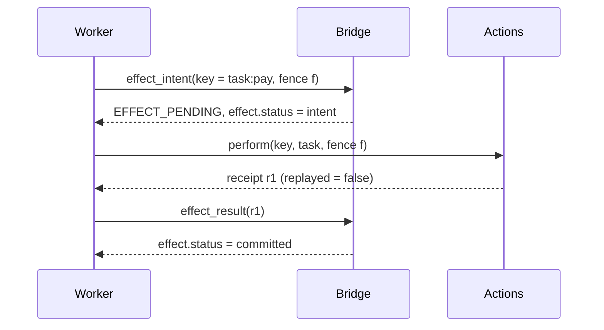

# Deduplication and Recovery

This file explains the two guarantees at the centre of PS-021 and exactly
what they rely on.

## The guarantees (precise wording)

1. **Task identity is preserved.** A task keeps the same `task_id` and
   `dialog_id` through agent crashes, bridge restarts, retries and reclaims.
2. **Duplicate side effects are rejected.** For any side effect performed
   through the actions service with an `effect_key`, the effect is performed at
   most once per key, and every retry of that key returns the original receipt.
3. **Duplicate requests are harmless.** Repeating any state-changing request
   with the same `request_id` returns the stored reply and changes nothing.

These hold under the assumptions listed at the end. We do **not** claim
exactly-once delivery in general ([LIMITATIONS.md](LIMITATIONS.md)).

## Four layers of protection

| Layer | Where | Stops |
| --- | --- | --- |
| 1. Request inbox | Bridge, `inbox` table | The same request being processed twice (lost replies, network duplicates, retries) |
| 2. Atomic claim + lease | Bridge, `tasks` row update | Two agents working on the same task at the same time |
| 3. Fencing token | Bridge (all worker writes) and actions service | A slow or restarted "old" owner writing after someone else took over |
| 4. Effect ledger | Actions service, `ledger` table | The side effect itself happening twice, even if layers 1–3 were bypassed |

Layer 4 is deliberately independent. If the bridge loses track, the place where
money moves still refuses a repeated key.

## Layer 1: the inbox

- Every state-changing request carries a `request_id` derived from durable IDs
  ([IDENTIFIERS.md](IDENTIFIERS.md)).
- In the same transaction as the state change, the bridge stores
  `(request_id, body_hash, status_code, reply)`.
- Repeat with the same body → the stored reply, unchanged, plus a
  `duplicate_request` event.
- Repeat with a different body → `422 request_id_conflict`. Someone reused a
  key for a different request, which is a bug worth surfacing.
- Error replies are stored too, so a retried invalid request gets the same error.

## Layer 2: claims and leases

- Claiming is one atomic `UPDATE … WHERE state IN ('DISPATCHED','SUSPENDED')
  AND (lease_until IS NULL OR lease_until < now)` inside `BEGIN IMMEDIATE`.
  Exactly one of two simultaneous claimers gets `rowcount = 1`.
- The owner keeps its lease alive with heartbeats. No heartbeat → the watchdog
  marks the task SUSPENDED after `LEASE_SECONDS`.

## Layer 3: fences

- Every successful claim or resume increments `tasks.fence`.
- Every worker write carries the fence it was given. Lower than current → `409 stale_fence`.
- The actions service remembers the highest fence it has seen per `task_id`
  and rejects lower ones the same way.

Example, the "slow, not dead" case:

| Time | Event | Fence |
| --- | --- | --- |
| t0 | B claims task | 1 |
| t1 | B is delayed; heartbeats stop arriving | 1 |
| t2 | Watchdog: lease expired → SUSPENDED | 1 |
| t3 | B2 claims → IN_PROGRESS | 2 |
| t4 | B wakes up, sends checkpoint with fence 1 | **rejected: stale_fence** |
| t5 | B stops working on the task | — |

## Layer 4: the effect protocol

Where a crash can happen, and what recovery does:

| Crash point | After restart the bridge says | Worker does | Result |
| --- | --- | --- | --- |
| before `effect_intent` | `effect.status = none` | Records intent, performs effect | 1 effect |
| after `effect_intent`, before actions call | `intent` | Calls actions with the same key | 1 effect (first real call) |
| after actions call, before `effect_result` | `intent` | Calls actions with the same key → **replayed** receipt | 1 effect, `duplicate_rejected` logged |
| after `effect_result` | `committed` | Skips the effect, continues with the next step | 1 effect |

The third row is scenario S4 and extra X1: the outcome was unknown to the
worker, and the ledger resolves it.

## Recovery procedures

### Worker (Agent B or B2) restart

1. `agent.register`.
2. `task.resume`: the bridge returns every task this agent owned that is not
   terminal, re-claims each with a new fence, and includes `last_checkpoint`
   and `effect` state.
3. For each task, continue from `last_checkpoint.step_index + 1`, following the
   effect table above for the side-effect step.
4. If the task was reclaimed by another worker in the meantime, it is not
   returned by `resume`; the agent simply moves on.

### Orchestrator (Agent A) restart

1. `agent.register`.
2. Read open dialogs from the bridge; rebuild the chat view from events.
3. Any user message whose `dialog.create` may not have completed (kept as
   *pending* in `data/<mode>/agent_a.json` until the create is done) is
   retried with the same `{msg_id}:create`. The inbox returns the existing
   dialog, so tasks are never created twice (extra test X3).

### Bridge restart

1. Startup recovery runs before serving ([BRIDGE.md](BRIDGE.md#background-jobs)).
2. Agents see connection errors during the restart and retry with the same
   `request_id`s. Requests that were committed before the crash return their
   stored replies; requests that were not committed are processed fresh.
3. Agents call `events.since(last_seq)` to catch up; the sequence continues
   without gaps because `seq` is an autoincrement column.
4. The dashboard reconnects its WebSocket and catches up the same way.

## Assumptions

The guarantees above depend on:

- one bridge process and one SQLite file on a local disk;
- `PRAGMA synchronous = FULL` (a committed transaction survives a hard kill);
- the actions service honouring `effect_key` and fences (it is ours, so we can
  ensure this; a real third-party service might not);
- agents deriving keys from durable IDs, never from random values;
- leases measured on one clock (the bridge's).

Breaking any of these is outside the prototype's scope.

## Proving the protection is real

`DISABLE_DEDUP=1` turns off layers 1 and 4 (inbox lookups and ledger key
checks). With it set, S1 and S4 **must fail**, showing duplicate effects. This
is the mutation check M1 in [TESTING.md](TESTING.md) and the "protection
on/off" switch on the dashboard. It is for testing only and is shown in a
warning colour.
