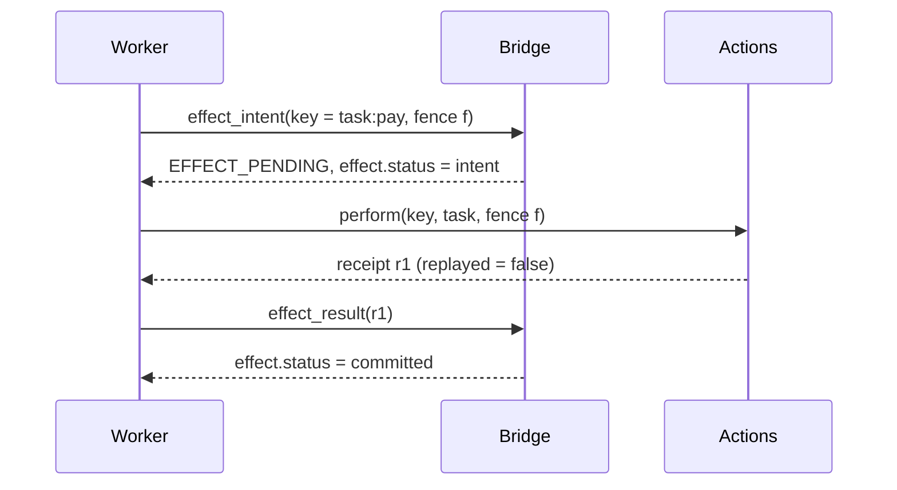

# Deduplication and Recovery

This file explains the two guarantees at the centre of PS-021 and exactly
what they rely on.

## The guarantees (precise wording)

1. **Task identity is preserved.** A task keeps the same `task_id` and
   `dialog_id` through agent crashes, bridge restarts, retries and reclaims.
2. **Duplicate side effects are rejected.** For any side effect performed
   through the actions service with an `effect_key`, the effect is performed at
   most once per key, and every retry of that key returns the original receipt.
3. **Duplicate requests are harmless.** Repeating any state-changing request
   with the same `request_id` returns the stored reply and changes nothing.

These hold under the assumptions listed at the end. We do **not** claim
exactly-once delivery in general ([LIMITATIONS.md](LIMITATIONS.md)).

## The delivery model in one sentence

**At-least-once delivery + an idempotent receiver + a single fenced writer = no
duplicate side effects, within the assumptions below.** Messages may be sent
more than once; the receiver makes the repeats harmless. This is a statement
about this prototype, not about networks in general
([LIMITATIONS.md](LIMITATIONS.md)).

## Four layers of protection

| Layer | Where | Stops |
| --- | --- | --- |
| 1. Request inbox | Bridge, `inbox` table | The same request being processed twice (lost replies, network duplicates, retries) |
| 2. Atomic claim + lease | Bridge, `tasks` row update | Two agents working on the same task at the same time |
| 3. Fencing token | Bridge (all worker writes) and actions service | A slow or restarted "old" owner writing after someone else took over |
| 4. Effect ledger | Actions service, `ledger` table | The side effect itself happening twice, even if layers 1–3 were bypassed |

Layer 4 is deliberately independent. If the bridge loses track, the place where
money moves still refuses a repeated key.

## Layer 1: the inbox

- Every state-changing request carries a `request_id` derived from durable IDs
  ([IDENTIFIERS.md](IDENTIFIERS.md)).
- In the same transaction as the state change, the bridge stores
  `(request_id, body_hash, status_code, reply)`.
- Repeat with the same body → the stored reply, unchanged, plus a
  `duplicate_request` event.
- Repeat with a different body → `422 request_id_conflict`. Someone reused a
  key for a different request, which is a bug worth surfacing.
- Error replies are stored too, so a retried invalid request gets the same error.

## Layer 2: claims and leases

- Claiming is one atomic `UPDATE … WHERE state IN ('DISPATCHED','SUSPENDED')
  AND (lease_until IS NULL OR lease_until < now)` inside `BEGIN IMMEDIATE`.
  Exactly one of two simultaneous claimers gets `rowcount = 1`.
- The owner keeps its lease alive with heartbeats. No heartbeat → the watchdog
  marks the task SUSPENDED after `LEASE_SECONDS`.

## Layer 3: fences

- Every successful claim or resume increments `tasks.fence`.
- Every worker write carries the fence it was given. Lower than current → `409 stale_fence`.
- The actions service remembers the highest fence it has seen per `task_id`
  and rejects lower ones the same way.

Example, the "slow, not dead" case:

| Time | Event | Fence |
| --- | --- | --- |
| t0 | B claims task | 1 |
| t1 | B is delayed; heartbeats stop arriving | 1 |
| t2 | Watchdog: lease expired → SUSPENDED | 1 |
| t3 | B2 claims → IN_PROGRESS | 2 |
| t4 | B wakes up, sends checkpoint with fence 1 | **rejected: stale_fence** |
| t5 | B stops working on the task | — |

## Layer 4: the effect protocol

Where a crash can happen, and what recovery does:

| Crash point | After restart the bridge says | Worker does | Result |
| --- | --- | --- | --- |
| before `effect_intent` | `effect.status = none` | Records intent, performs effect | 1 effect |
| after `effect_intent`, before actions call | `intent` | Calls actions with the same key | 1 effect (first real call) |
| after actions call, before `effect_result` | `intent` | Calls actions with the same key → **replayed** receipt | 1 effect, `duplicate_rejected` logged |
| after `effect_result` | `committed` | Skips the effect, continues with the next step | 1 effect |

The third row is scenario S4 and extra X1: the outcome was unknown to the
worker, and the ledger resolves it.

## Recovery procedures

### Worker (Agent B or B2) restart

1. `agent.register`.
2. `task.resume`: the bridge returns every task this agent owned that is not
   terminal, re-claims each with a new fence, and includes `last_checkpoint`
   and `effect` state.
3. For each task, continue from `last_checkpoint.step_index + 1`, following the
   effect table above for the side-effect step.
4. If the task was reclaimed by another worker in the meantime, it is not
   returned by `resume`; the agent simply moves on.

### Orchestrator (Agent A) restart

1. `agent.register`.
2. Read open dialogs from the bridge; rebuild the chat view from events.
3. Any user message whose `dialog.create` may not have completed (kept as
   *pending* in `data/<mode>/agent_a.json` until the create is done) is
   retried with the same `{msg_id}:create`. The inbox returns the existing
   dialog, so tasks are never created twice (extra test X3).

### Bridge restart

1. Startup recovery runs before serving ([BRIDGE.md](BRIDGE.md#background-jobs)).
2. Agents see connection errors during the restart and retry with the same
   `request_id`s. Requests that were committed before the crash return their
   stored replies; requests that were not committed are processed fresh.
3. Agents call `events.since(last_seq)` to catch up; the sequence continues
   without gaps because `seq` is an autoincrement column.
4. The dashboard reconnects its WebSocket and catches up the same way.

## Evidence: three answers, and "unknown" is not "no"

When a worker comes back after a crash between "I am about to act" and "I
recorded the result", it asks the actions ledger what it knows
(`GET /audit/{key}`, read-only) and gets one of three answers:

| Answer | Meaning | What the worker does |
| --- | --- | --- |
| `VERIFIED_DONE` | The ledger holds the key: the effect happened | Retries with the same key and receives the original receipt |
| `VERIFIED_NOT_EXECUTED` | The ledger answered and does not hold the key | Performs it, with that key |
| `UNKNOWN` | No trustworthy answer (the service is unreachable or errored) | Retries with the same key; it never assumes "not done" |

In every case the worker's action is the same safe one, a retry with the same
key, so the evidence explains what it found rather than deciding anything
(`adapters/evidence.py`; the answer is in Agent B's log, shown by S4). A
ledger row proves the effect happened only for this prototype's own ledger; it
is not a universal proof about an outside system.

## Failure and recovery matrix

Every row is proven by a test in `tests/`; the numbers are in
[RESULTS.md](RESULTS.md).

| Failure | What is lost | What survives | Recovery | Result | Proven by |
| --- | --- | --- | --- | --- | --- |
| Reply to `dialog.create` lost | Agent A's copy of the reply | The dialog in the bridge; Agent A's pending list | Agent A retries `{msg_id}:create`; the inbox returns the stored reply | One dialog, one task, one payment | S1 |
| Two workers claim one task | Nothing | The task row | One claim wins inside the transaction; the other gets `already_claimed` | One winner, one payment | S2 |
| Worker crashes before the side effect | The worker's memory | Checkpoints, fence | Resume from the last checkpoint with a higher fence | Earlier steps not redone; one payment | S3 |
| Worker crashes **after** the side effect, before reporting it | What the worker knew | The ledger row, the recorded intent | Resume; the same key returns the original receipt | One payment, same receipt | S4 |
| Bridge hard-killed during a network cut | Requests in flight | SQLite database and event log | Startup recovery; agents retry the same IDs and catch up with `events.since` | Same task completes; event numbers continue; the log rebuilds the database | S5 |
| Reply from the actions service lost | The reply | The ledger row | The worker retries the same key | Original receipt, no second effect | X1 |
| Worker slow, not dead | Nothing | Its heartbeats keep the lease | No reclaim | One owner throughout | X2 |
| Agent A crashes right after creating the dialog | Agent A's memory | The dialog in the bridge | Agent A retries; the inbox absorbs it | One dialog | X3 |
| Worker crashes at the same point every time | Nothing | Attempt count | After `max_attempts` the task fails | `FAILED`, no payment | X4 |
| Cancel after the payment | Nothing | The committed effect | Cancel refused (`invalid_transition`) | The payment stands | X5 |
| First task fails | Nothing | Dependent tasks | They are cancelled and never claimed | No orphan work | X6 |
| A request delivered twice | Nothing | The inbox | The repeat returns the stored reply | One checkpoint | X7 |
| Worker crashes and the user is asked | The worker's memory | The hold, checkpoints, progress report | The user chooses Continue; the worker resumes from the progress report | One payment, nothing redone | X8 |
| An old owner writes after a takeover | Nothing | The fence | Refused as `stale_fence` | Nothing overwritten | R3 |
| Same request ID, different body | Nothing | The inbox | Refused with 422 | The original reply unchanged | R4 |
| Random faults, crashes and restarts together | Various | All of the above | All of the above | 0 duplicate side effects; the log rebuilds the database | C1, M2 |
| Protection switched off on purpose | | | None | Duplicates appear, which proves the tests can catch them | M1, M2 |

Not covered: loss of the bridge's disk, a corrupted database file, clock jumps
on the bridge machine, and an outside service with no idempotency key
([LIMITATIONS.md](LIMITATIONS.md)).

## Assumptions

The guarantees above depend on:

- one bridge process and one SQLite file on a local disk;
- `PRAGMA synchronous = FULL` (a committed transaction survives a hard kill);
- the actions service honouring `effect_key` and fences (it is ours, so we can
  ensure this; a real third-party service might not);
- agents deriving keys from durable IDs, never from random values;
- leases measured on one clock (the bridge's).

Breaking any of these is outside the prototype's scope.

## Proving the protection is real

`DISABLE_DEDUP=1` turns off layers 1 and 4 (inbox lookups and ledger key
checks). One dialog per `msg_id` is also a dedup rule, so the bridge drops
that too (the UNIQUE constraint and the reuse check); this applies only to a
freshly wiped world. With it set, S1 and S4 **must fail**, showing duplicate effects. This
is the mutation check M1 in [TESTING.md](TESTING.md) and the "protection
on/off" switch on the dashboard. It is for testing only and is shown in a
warning colour.
