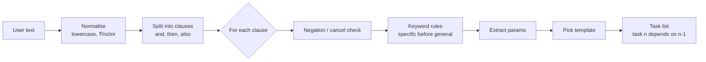

# Rule-Based Intent Routing

Agent A accepts **any** text and turns it into one or more tasks. It does this
with a rule-based intent router: keyword rules choose an intent, simple
patterns extract details, and each intent maps to a fixed step template.

This is a scripted mechanism, and the dashboard labels it as such ("scripted
mode"). It is predictable on purpose, so every test is repeatable.

## Pipeline



## Intents and templates

| Intent | Example text | Keywords (checked in this order) | Steps | Side effect |
| --- | --- | --- | --- | --- |
| `lookup` | "check my payment history", "find the HK-204 booking" | `history`, `status`, `find`, `search`, `look up`, `check`, `summarise`, `summarize`, `show` | parse → search → summarise → report | none |
| `payment` | "pay ₹40 to the bakery", "buy two tickets" | `pay`, `buy`, `purchase`, `transfer`, `send money`, `order` | parse → plan → **pay** → verify → report | `pay` |
| `message` | "email the receipt to Rahul", "notify the team" | `email`, `mail`, `message`, `notify`, `text`, `tell`, `send` | parse → draft → **send** → report | `send` |
| `booking` | "book a room for Friday", "reserve a table" | `book`, `reserve`, `schedule`, `appointment` | parse → check_slot → **reserve** → report | `reserve` |
| `general` | anything else | — | parse → plan → work → report | none |

Order matters: `lookup` is checked first so "check my **payment** history" is a
lookup, not a payment. Within side-effect intents, `send money` is checked
before `send` so it routes to payment.

## Clause splitting

Split on ` and `, ` then `, ` also `, `;`, `.` **only if both sides contain a
keyword** from some intent. "Bread and butter" stays one clause; "pay the bill
and email the receipt" becomes two.

Each clause becomes one task. Within one message, task *n* depends on task
*n-1* (sequential by default). This is what makes "email the receipt" wait for
the payment.

## Negation and cancel

Before keyword matching, check the clause for `don't`, `do not`, `never`,
`cancel`, `stop`, `hold off`, `not yet`.

- With a task reference ("cancel the payment", "cancel tsk_…") → `cancel`
  command on the most recent matching open task. No new task is created.
- Otherwise ("don't pay yet") → no task; Agent A replies that nothing was
  scheduled.

## Parameter extraction

| Param | Pattern (simplified) | Default |
| --- | --- | --- |
| `amount` | `(?:₹|rs\.?|inr)\s*(\d+(?:\.\d+)?)` or `(\d+)\s*(?:rupees|rs|inr)` | none → payment asks for confirmation with amount "unspecified" |
| `currency` | from the symbol | `INR` |
| `payee` / `to` | `to (?:the )?([\w\- ]+?)(?:$| and| then| for| on|,)` | `"unknown"` |
| `item` | after `buy` / `order` | none |
| `day` | `monday`…`sunday`, `today`, `tomorrow` | none |
| `time` | `\d{1,2}(:\d{2})?\s*(am|pm)` | none |
| `ref` | `[A-Z]{2}-\d{2,4}` (e.g. HK-204) | none |

Extracted params go into the task's `params` and into step labels, so the
dashboard shows "pay ₹40 to bakery" instead of "step 3".

## Output shape

```python
route("Pay ₹40 to the bakery and email the receipt to Rahul")
# ->
[
  {"intent": "payment", "action": "pay",
   "params": {"amount": 40, "currency": "INR", "payee": "bakery"},
   "steps": ["parse", "plan", "pay", "verify", "report"],
   "needs_confirmation": True, "depends_on": []},
  {"intent": "message", "action": "send",
   "params": {"to": "Rahul", "body": "receipt"},
   "steps": ["parse", "draft", "send", "report"],
   "needs_confirmation": True, "depends_on": [1]},
]
```

Every routing decision also returns `matched` (keyword and rule that fired) so
the chat can show *"Detected intent: payment · ₹40 · bakery · scripted mode"*.

## Test table

`tests/test_router.py` runs a table of inputs → expected intents and params.
Start with at least these:

| Input | Expected |
| --- | --- |
| `pay ₹40 to the bakery` | payment, amount 40, payee bakery |
| `check my payment history` | lookup |
| `don't pay yet` | no tasks |
| `pay the bill and email the receipt to Rahul` | payment, then message (depends on 1) |
| `book a room for friday 5pm` | booking, day friday, time 5pm |
| `send money to Asha` | payment (not message) |
| `bread and butter` | general (one clause) |
| `write me a poem` | general |
| `cancel the payment` | cancel command |
| `find booking HK-204` | lookup, ref HK-204 |

## LLM mode (optional)

`ROUTER=llm` replaces `route()` with `llm_router.route()`, which asks a local
model through Ollama (`http://localhost:11434`) to return the **same output
shape** as JSON.

- Model: `qwen3.5:9b` on a capable GPU, `qwen3.5:4b` on a laptop. `gemma4:e4b`
  is an alternative. Confirm exact tags in the Ollama library before the event.
- Temperature 0; the prompt lists the allowed intents and step templates.
- The response is validated with the same Pydantic model. Unknown intents,
  invalid JSON or a timeout over `LLM_TIMEOUT` → **fall back to the rule
  router**, and the chat says so.
- The LLM only decides *what* to do. Templates, keys, the bridge and the
  actions service still decide *how*, so correctness never depends on the model.
- Tests never use LLM mode.
