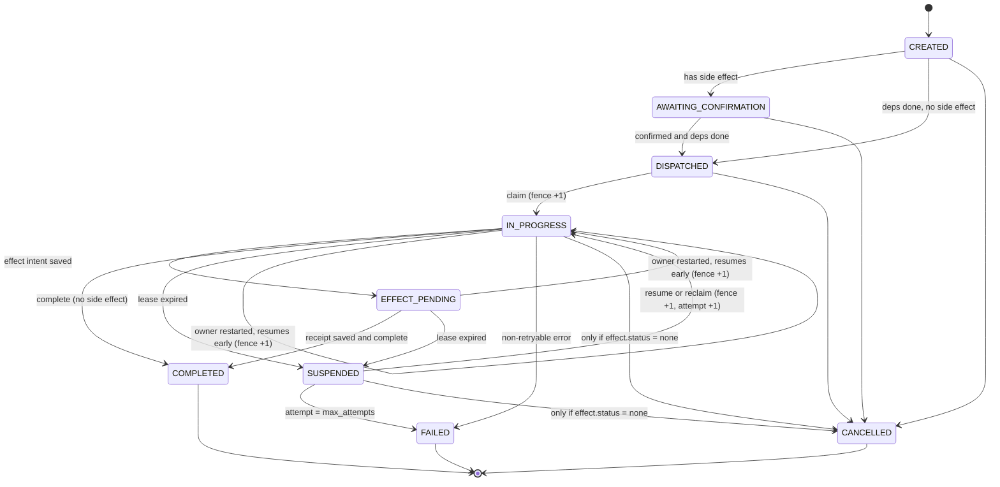

# Task Lifecycle State Machine

Every task is in exactly one state. The bridge allows only the transitions
listed here. Any other request is rejected with `409 invalid_transition`,
nothing is changed, and an `invalid_transition_rejected` event is logged.

## States

| State | Meaning | Terminal? |
| --- | --- | --- |
| `CREATED` | Task exists; not yet ready (waiting for dependencies) | no |
| `AWAITING_CONFIRMATION` | Task has a side effect and the user has not confirmed yet | no |
| `DISPATCHED` | Ready; any worker may claim it | no |
| `IN_PROGRESS` | Claimed; the owner holds a lease and a fence | no |
| `EFFECT_PENDING` | The owner recorded a side-effect intent; the effect may or may not have happened yet | no |
| `SUSPENDED` | The owner's lease expired (crash, disconnect, or too slow); waiting to be resumed or reclaimed | no |
| `COMPLETED` | Finished successfully | **yes** |
| `FAILED` | Gave up (max attempts, or a non-retryable error) | **yes** |
| `CANCELLED` | Cancelled by the user, or because a dependency failed | **yes** |

## Diagram



## Transition table

| From | To | Triggered by | Guard (must be true) | Side changes |
| --- | --- | --- | --- | --- |
| CREATED | AWAITING_CONFIRMATION | Dispatcher | `needs_confirmation` and not `confirmed` | — |
| CREATED | DISPATCHED | Dispatcher | deps COMPLETED; no confirmation needed (or already confirmed) | — |
| AWAITING_CONFIRMATION | DISPATCHED | Dispatcher | `confirmed` and deps COMPLETED | — |
| DISPATCHED | IN_PROGRESS | `task.claim` / `task.claim_next` | no valid lease held by anyone | owner set, `fence += 1`, `attempt = 1`, lease set |
| IN_PROGRESS | EFFECT_PENDING | `task.effect_intent` | sender is owner, fence current, `effect.status = none` | `effect.key`, `effect.status = intent` |
| IN_PROGRESS | COMPLETED | `task.complete` | owner, fence current, task has no side effect **or** `effect.status = committed` | result stored, lease cleared |
| EFFECT_PENDING | COMPLETED | `task.complete` | owner, fence current, `effect.status = committed` | result stored, lease cleared |
| IN_PROGRESS / EFFECT_PENDING | SUSPENDED | Watchdog | `lease_until < now` | `lease_expired` event |
| SUSPENDED | IN_PROGRESS | `task.resume` / `task.claim` | `attempt < max_attempts` | new owner (may be same), `fence += 1`, `attempt += 1`, lease set |
| IN_PROGRESS / EFFECT_PENDING | IN_PROGRESS | `task.resume` by the **current owner** before its lease expired (it restarted quickly) | sender is owner; `attempt < max_attempts` | `fence += 1`, `attempt += 1`, lease renewed; `resumed` event |
| SUSPENDED | FAILED | Watchdog | `attempt >= max_attempts` | reason `max_attempts`; dependents cancelled |
| IN_PROGRESS | FAILED | `task.fail` with `retryable: false` | owner, fence current | reason stored; dependents cancelled |
| CREATED / AWAITING_CONFIRMATION / DISPATCHED | CANCELLED | `task.cancel` or dispatcher (dependency failed) | — | reason stored; dependents cancelled |
| IN_PROGRESS / SUSPENDED | CANCELLED | `task.cancel` | `effect.status = none` | lease cleared |

Notes:

- `task.effect_result` does **not** change the state. It sets
  `effect.status = committed` and stores the receipt. The task stays
  EFFECT_PENDING until `task.complete`.
- A resumed task always returns to `IN_PROGRESS`, even if it was EFFECT_PENDING
  before. The worker then sees `effect.status = intent` in the task record and
  repeats the side effect **with the same key**, which the actions service
  answers with the existing receipt. Calling `task.effect_intent` again with
  the same key is allowed and moves the task back to EFFECT_PENDING.
- A task with `effect.status` of `intent` or `committed` can **never** be
  cancelled: the side effect may already have happened.
- Terminal states accept no transitions at all.

## Mapping to A2A-style task states

| Bridge state | A2A-style `status.state` | Notes |
| --- | --- | --- |
| CREATED, DISPATCHED | `submitted` | |
| AWAITING_CONFIRMATION | `input-required` | |
| IN_PROGRESS, EFFECT_PENDING | `working` | |
| SUSPENDED | `working` + `metadata.bridge_state = "SUSPENDED"` | **No equivalent; carried in metadata** |
| COMPLETED | `completed` | |
| FAILED | `failed` | |
| CANCELLED | `canceled` | Note the spelling |

The SUSPENDED gap is a real finding: the mapping is lossy, and the bridge keeps
it lossless by always including `metadata.bridge_state`. The interoperability
tests check this round trip ([TESTING.md](TESTING.md), I1–I3).

## Implementation sketch

```python
ALLOWED = {
    ("CREATED", "AWAITING_CONFIRMATION"), ("CREATED", "DISPATCHED"),
    ("AWAITING_CONFIRMATION", "DISPATCHED"),
    ("DISPATCHED", "IN_PROGRESS"),
    ("IN_PROGRESS", "EFFECT_PENDING"), ("IN_PROGRESS", "COMPLETED"),
    ("EFFECT_PENDING", "COMPLETED"),
    ("IN_PROGRESS", "SUSPENDED"), ("EFFECT_PENDING", "SUSPENDED"),
    ("SUSPENDED", "IN_PROGRESS"),
    ("IN_PROGRESS", "IN_PROGRESS"), ("EFFECT_PENDING", "IN_PROGRESS"),  # early resume by owner ("SUSPENDED", "FAILED"), ("IN_PROGRESS", "FAILED"),
    ("CREATED", "CANCELLED"), ("AWAITING_CONFIRMATION", "CANCELLED"),
    ("DISPATCHED", "CANCELLED"), ("IN_PROGRESS", "CANCELLED"), ("SUSPENDED", "CANCELLED"),
}

def transition(task, to_state, guard_ok: bool):
    if (task.state, to_state) not in ALLOWED or not guard_ok:
        raise InvalidTransition(task.state, to_state)
```

Guards are separate functions so each can be unit-tested on its own.
